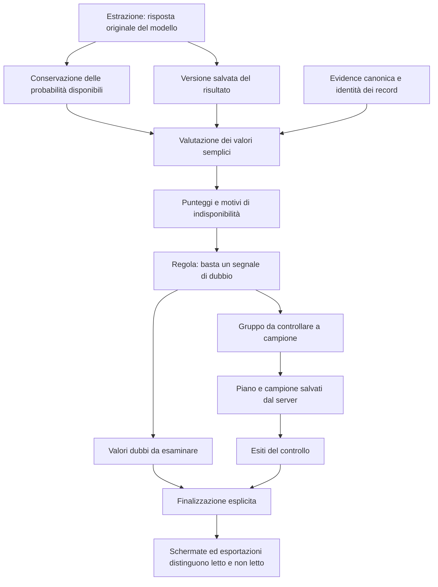
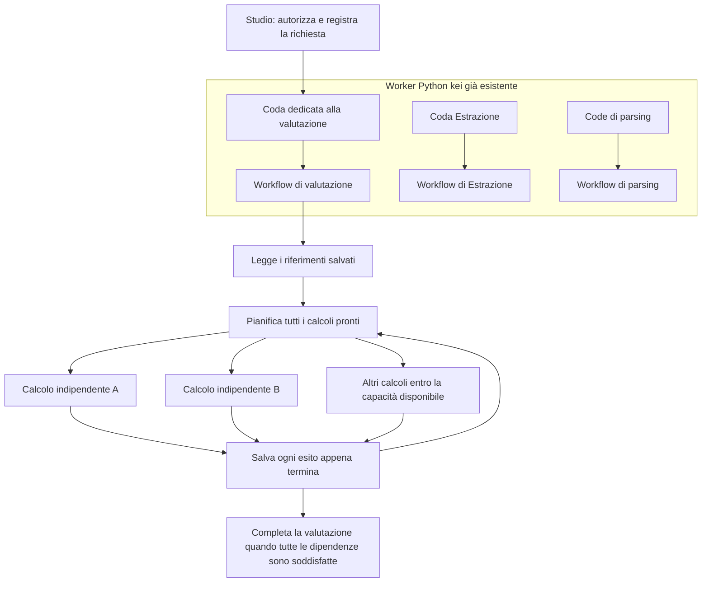
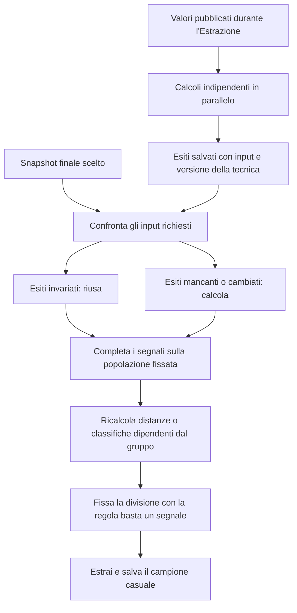
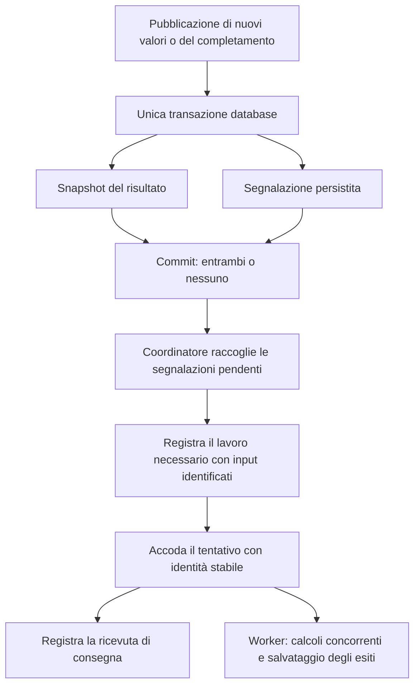

# Signal-guided review for large Extractions

* **Author:** Gennaro Baratta
* **Status:** Draft — Overview & Goals approved; Technical Plan decisions closed
  by the author on 2026-11-28, numeric parameters pending measurement
* **Date:** 2026-11-13, updated 2026-11-28
* **Predecessor:** [concepts_brief.md](./concepts_brief.md)

## Overview

FREE should help a Humanities Researcher review a large Extraction without
reading every extracted value. The researcher needs to know which values need
attention, what the review actually checked, and which values remain unread.

Three techniques assess doubt about each scalar value, including attributes
inside list items. Token probability measures how likely the extraction model
was to produce the text it wrote. An entailment model assesses whether the
linked Evidence supports that Field's value for that record. Embedding distance
measures how different a value or its Evidence is from others for the same
Field. Two existing hints also raise doubt: a value not printed as such in its
linked Evidence, and a value with no Evidence. These remain distinct inputs.
When a technique cannot run, FREE records why rather than treating its absence
as a reassuring score.

The scores divide one Extraction snapshot into a doubtful group and a confident
group. The researcher examines every scalar in the doubtful group. FREE then
draws a random check from the confident group. Passing that check allows the
remaining confident values to be accepted without individual inspection. Those
values stay visibly marked **accepted, not read**; FREE does not invent Review
Decisions for them. Values actually examined in the check are recorded as
examined. If the check fails, more values move to the doubtful group for review;
the rules for any further check remain to be decided.

The word confident names a group selected by the scores. It does not mean that
the scores are calibrated probabilities of correctness. The random check
provides the basis for a stated error limit and confidence level, under a plan
fixed before its outcomes are seen. Full manual review remains available.

## The Problem

A large Extraction can contain thousands of values. Today, finalization requires
an approve, edit or reject decision for every structurally valid saved value in
the named snapshot. A saved value can contain an entire object or list. Studio
also permits bulk approval in the Batch Extraction review grid. These rules
establish that decisions were recorded; they cannot establish that a researcher
read every value. Requiring more approval clicks does not resolve that gap.

The researcher needs a smaller, meaningful review workload and an honest record
of what that review supports. Scores alone cannot supply that assurance. A
faithfully copied OCR error or a value assigned to the wrong record can look
convincing to all three techniques. Embedding distance can flag rare valid
values while missing a repeated mistake. There are no real review labels
available to calibrate the techniques at this starting point.

A random check of the confident group tests the values the researcher would
otherwise leave unread. It also supplies labelled examples for evaluating the
scores later. A pass remains a statistical result, not a guarantee that every
unread value is right. Its scope excludes omitted values, records and list
items. An overall error limit also does not establish the same limit separately
for every Field.

This design proposes an explicit extension to the current review contract:
finalization may refer to a saved acceptance based on a random check, alongside
individual Review Decisions. Current finalizations continue to mean that the
required decisions exist for every saved value. They make no retrospective
claim that each value was read. The Technical Plan must identify the contract
and downstream changes needed before the new form of finalization is enabled.

## Goals

1. **Direct attention at the scalar level.** Assess each scalar, including
   attributes inside list items, using the three techniques and the two
   Evidence hints. Keep the contributing scores, their versions and reasons
   for unavailable techniques so the split can be explained later.
2. **Reduce review work while keeping a testable acceptance rule.** Require
   review of the doubtful group and a server-selected random check of the
   confident group. Fix the check plan before outcomes are seen, save the
   draws before showing them, and leave skipped draws unfinished. Ordinary
   review and bulk approvals do not count as random draws. The precise error
   limit, confidence level, sample size and workload target remain open.
3. **Preserve what the check found.** Record whether the original checked
   value had wrong content, belonged to the wrong record, or lacked supporting
   Evidence. Save that finding separately from an approve, edit or reject
   decision. Correcting a value must not erase its original error label.
4. **Make acceptance auditable for one snapshot.** Keep the assessed scalar
   population, group membership, score versions, check plan, draws, findings
   and acceptance outcome. Finalization must identify the acceptance it uses.
   An acceptance does not transfer to another or changed Extraction.
5. **Show which values were examined.** Review screens, finalization and
   exports must distinguish individually examined values from values accepted
   unread. Acceptance must not generate individual approvals. The exact
   display and export layouts remain to be decided.
6. **Measure the techniques before product integration.** Compare each
   technique against random ordering on the synthetic benchmark, including
   OCR-corruption and wrong-record cases. Measure its ability to bring errors
   forward and its execution cost. Synthetic results can expose weaknesses;
   they cannot establish accuracy on research documents. Criteria for taking
   a technique into the product remain to be decided.
7. **Retain the evidence needed to improve the split.** Save each random
   check's labels alongside the scores available when it was drawn. Later
   tuning must not rewrite earlier assessments or acceptance records.

## Non-Goals

* Detecting or estimating omitted values, records or list items.
* Guaranteeing that every accepted value is right, or that an overall check
  establishes an error limit for each Field separately.
* Certifying a collection of Source Documents. The first release assesses one
  Extraction snapshot at a time.
* Carrying an acceptance into a new or changed Extraction.
* Adding OCR confidence, agreement between repeated Extractions, or a trained
  error classifier in this release.
* Giving individual list items their own editable Review Decision state.
  Scoring an attribute separately does not change today's correction unit.
* Treating a synthetic benchmark result as proof of accuracy on research
  documents, or promising a fixed reduction in workload before measurement.

## Open Questions

These are unresolved choices from the brief, not decisions made by this draft.
They must be resolved before the relevant Technical Plan is approved. The
author resolved them on 2026-11-28 in the Technical Plan below, and this list
is kept as the historical record. What remains to measurement, including
which languages and providers are supported, is listed there under
«Parametri da fissare con le misure».

* **Thresholds and missing inputs:** the author has selected the initial rule
  that any doubt flag is sufficient. Thresholds, the proposed most doubtful
  20% per technique, and what happens when no technique can run remain open.
  A weighted formula is a future possibility, not part of this first rule.
* **Check plan and repeated attempts:** the error limit, confidence level,
  sample size for the actual population, treatment of different Fields, and
  rules for moving values after failure. Any repeat-check rule must account
  for repeated opportunities to pass rather than silently reuse a one-check
  confidence claim. The brief's approximate sample figures are not selected
  requirements.
* **Composite edits:** whether editing an object or list sends that whole
  saved value to full review, and how the assessment handles changed scalar
  positions.
* **Eligibility and pilots:** whether admission requires a completed snapshot
  from one Producing Input Selection with no provisional values, and whether
  pilots must retain full review before Schema Revision stabilisation.
* **Presentation and exports:** how scalar examination and acceptance are
  represented in Studio, workbooks and CSV, including the proposed scalar
  status table and adjacent CSV status columns.
* **Technique evaluation and delivery:** benchmark pass criteria, supported
  languages and providers, acceptable model costs, and the proposed opt-in
  rollout after measurement. No new model or dependency is selected here.

## Piano tecnico

Panoramica e obiettivi approvati dall'autore. Il 2026-11-13 l'autore ha scelto
il worker Python esistente, con coda e limiti dedicati, per la valutazione in
background. Il 2026-11-28 ha chiuso le scelte rimaste aperte, dopo una
revisione indipendente in sola lettura del draft e del codice (Codex,
`gpt-6.2-astra`). Restano da fissare con le misure soltanto i parametri
numerici elencati alla fine.

### Punti di partenza verificati nel codice

* Studio gestisce autenticazione, proprietà dei Project Context, Review
  Decisions e finalizzazione. Il Parsing Service gestisce Estrazione,
  Evidence canonica e il worker Python. La sua API non accede al database.
* Una versione salvata del risultato conserva valori e riferimenti agli input
  di produzione. L'attuale finalizzazione nomina quella versione e una
  Decision Version; richiede una decisione compatibile per ogni valore salvato
  (`processing` `saved`): un valore `absent` si può compilare e non richiede
  decisione.
* Dal 2026-11-18 ogni valore durevole può portare un `check` opzionale
  (protocol 1, `valueCheckSchema` in `durable-contract.ts`): per ogni scalare
  giudicato uno stato e un'etichetta 0/1; l'impronta dell'input può mancare
  e l'identità del checker può essere vuota. Vive dentro `snapshot.values`,
  che il database rende immutabile. Il rail dei risultati di Studio lo
  consuma già; manca il produttore.
* Studio ordina già la revisione «Check first» (PR #419): Evidence assente,
  corrispondenza inesatta, Value Disagreement ed etichette 0 di `check`
  vengono prima. Intercala campioni anticipati deterministici presi dal resto
  e, durante la sessione, riporta al loro posto i motivi deboli dopo tre
  approvazioni (`reviewQueue.ts`, `reviewLearning.ts`). È un ordine, non un
  campione casuale.
* Una correzione può sostituire un intero oggetto o una lista. La funzione
  `valueParts` di Studio distingue già gli attributi e i loro percorsi per
  mostrarli, ma usa anche le correzioni: non può identificare da sola la
  popolazione originale da sottoporre a controllo. Le approvazioni di singole
  celle sono durevoli e appartengono a snapshot e Decision Version;
  un'approvazione dell'intera tabella non prova l'esame delle celle. Il
  percorso delle celle originali (`table-cell-review.ts`) salta gli elementi
  delle liste di primitivi.
* Le richieste di Estrazione non chiedono le probabilità dei token e `Reply`
  non le conserva; la trascrizione OCR sa già chiederle. Il protocollo
  durevole valida le chiavi delle richieste: la raccolta delle probabilità
  richiederà modifiche coordinate, non soltanto un parametro nel client HTTP.
  Il metodo unificato delle Catalog ha ritirato la verifica di ogni valore:
  non esiste una chiamata di verifica generale da cui leggerle.
* La prima stabilizzazione di un Extraction Schema richiede oggi un risultato
  corrente finalizzato della Schema Revision interessata. Una revisione
  successiva dello stesso schema già stabilizzato non richiede necessariamente
  un nuovo pilot. La politica per la nuova forma di accettazione è in «Pilot».

### Struttura funzionale

Le frecce descrivono responsabilità logiche; tabelle, endpoint, processi e
soglie sono nelle sezioni seguenti. Le probabilità delle chiamate originali
non possono essere recuperate dai soli valori già salvati: una nuova chiamata
al modello produrrebbe una nuova osservazione. Per quelle Estrazioni il segnale
originale è indisponibile, salvo dati già conservati che lo documentino.

La valutazione deve riferire ogni attributo alla versione originale esaminata,
al valore salvato che lo contiene e al percorso al suo interno. La
conservazione è descritta in «Righe separate e `check` composto in lettura»,
le modifiche successive in «Decisioni esistenti, modifiche e Value
Disagreements». Un errore trovato nel campione resta registrato dopo la
correzione.

### Prima scelta architetturale: esecuzione dei calcoli

**Decisione dell'autore: opzione A.** La valutazione viene eseguita in background
dal worker Python esistente, con stato salvato, coda e limiti dedicati. Resta
distinta dall'operazione che ha prodotto i valori. Studio mantiene la gestione
della revisione. L'opzione B rimane registrata per la successiva sezione sulle
alternative; il suo maggior costo di gestione è un compromesso dell'opzione,
non una motivazione di rifiuto attribuita all'autore senza conferma.

| Opzione | Meccanismo | Compromesso e condizione di fallimento |
| --- | --- | --- |
| A — Worker Python esistente | Un nuovo workflow DBOS, con coda e limiti propri, nel worker del Parsing Service. Riusa librerie Python e lettura della sorgente canonica. | Aggiunge meno processi da gestire. Memoria, CPU e risorse dei modelli restano condivise: la sola coda separata non impedisce che il calcolo rallenti parsing ed Estrazione. Non basta se il carico richiede isolamento delle risorse. |
| B — Worker Python dedicato | Un processo distinto esegue la valutazione, riusando il codice necessario del Parsing Service e leggendo solo i dati ammessi. Studio avvia e consulta il lavoro. | Permette limiti e riavvii separati, ma aggiunge configurazione, permessi e gestione del recupero. Separare i processi non isola automaticamente una GPU condivisa. Non va trattato come una seconda copia indistinta del worker attuale: lock e cancellazione della cronologia dipendono oggi dal processo che li possiede. |

### Esecuzione nel worker esistente

Si aggiunge una coda di valutazione al worker `kei` e un workflow distinto
dall'Estrazione. I nomi tecnici provvisori sono `kei-review-scoring` per la coda
e `scoreExtractionReviewV1` per il workflow; non introducono nomi visibili al
Ricercatore. L'avvio riceve l'identità della valutazione: i riferimenti a
risultato, sorgente e modelli vengono letti dai dati salvati, non da contenuto
del documento passato come argomento al workflow. L'avvio segue il calcolo
anticipato e la segnalazione nella transazione di pubblicazione, descritti
sotto.

Il diagramma rappresenta i passaggi logici, non una scelta già approvata sulla
forma delle tabelle o sulla dimensione delle porzioni.

Il codice esistente impone i seguenti vincoli all'implementazione:

* Solo il worker registra le code e i loro limiti. Studio accoda per nome e
  non registra la coda, perché potrebbe sovrascriverne la configurazione.
* Il limite globale e quello per worker devono essere coerenti con la
  capacità fisica. Una cancellazione non significa che una chiamata nativa
  abbia già liberato memoria o risorse di calcolo.
* Limitare il numero di valutazioni non basta: occorre limitare anche il
  lavoro in parallelo e il volume dei dati trattati dentro ogni valutazione.
  I valori numerici e le risorse dei modelli saranno definiti dopo le misure;
  la scelta A non promette assenza di rallentamenti alle altre code.
* Il ruolo `kei` non legge liberamente i dati di Studio. Nuove operazioni
  sullo stato della valutazione devono passare da routine autorizzate e
  circoscritte, senza assegnare credenziali amministrative al worker.
* Nessuna transazione o connessione database rimane occupata durante un
  calcolo del modello. Lettura, calcolo e salvataggio sono confini distinti.
* Il nuovo workflow deve essere registrato dal punto di avvio del worker.
  Le modifiche alla sequenza di passi di un workflow esistente richiedono
  `DBOS.patch()`; non si cambia la versione dell'applicazione per aggirare
  il recupero dei lavori già avviati.

La ripresa deve riutilizzare le porzioni già salvate della stessa valutazione
e degli stessi input. Un calcolo completato soltanto in memoria può essere
ripetuto dopo un crash: non si promette esecuzione esattamente una volta.
Richieste duplicate e riprese non devono pubblicare due esiti per la stessa
porzione. La registrazione atomica dell'avvio, la conservazione dei punteggi e
la cancellazione del Progetto sono decise nelle sezioni seguenti. Un errore
nel calcolo lascia incompleta
la valutazione; non equivale a un punteggio basso né a un controllo superato.

### Decisione dell'autore: basta un segnale di dubbio

I tre punteggi hanno scale diverse; non si sommano direttamente. La prima
versione non dispone di dati reali con cui calibrare una probabilità d'errore.
L'autore ha scelto la regola 1: basta un segnale di dubbio. Le soglie sono in
«Soglie assolute per versione». La regola con pesi resta una possibile evoluzione da
valutare con l'esperienza raccolta, non un secondo comportamento da costruire
adesso.

| Opzione | Meccanismo | Compromesso e condizione di fallimento |
| --- | --- | --- |
| 1 — Basta un segnale di dubbio | Ciascuna tecnica segnala i propri valori più dubbi secondo una soglia da fissare. Un valore segnalato da almeno una tecnica, senza Evidence o non stampato come tale nell'Evidence, va nel gruppo dubbio. Si conservano tutti i motivi. | La spiegazione è diretta e un segnale rassicurante non cancella un allarme. Una tecnica rumorosa, o una trasformazione valida del testo, può però mandare molti valori in revisione e annullare il risparmio di lavoro. |
| 2 — Punteggio combinato | Si trasformano i risultati in scale confrontabili e si combinano con pesi espliciti, includendo le penalità per Evidence mancante e corrispondenza inesatta. Una soglia sul totale divide i gruppi. | Permette di bilanciare segnali rumorosi. Senza dati etichettati, trasformazioni e pesi restano ipotesi; segnali rassicuranti possono compensare un allarme reale. Il totale non è una probabilità calibrata di correttezza. |

Nessuna delle due regole autorizza l'accettazione senza controllo casuale.
Un dato mancante non viene riempito con un punteggio rassicurante; le
tecniche indisponibili, compreso il caso in cui nessuna possa essere
eseguita, sono trattate in «Soglie assolute per versione».

### Separazione delle responsabilità e lavoro concorrente

L'autore richiede una separazione modulare a design time e il massimo uso di
interleaving e parallelizzazione compatibile con le dipendenze dei dati e la
capacità fisica. Condividere il processo non deve mescolare le responsabilità.
I confini sotto descrivono moduli logici con una funzione completa, non un
obbligo di creare un file, una classe o un servizio per ogni riga.

| Responsabilità | Input e risultato | Cosa non decide |
| --- | --- | --- |
| Calcolo dei segnali | Legge il valore originale, il contesto del record, l'Evidence e gli eventuali dati della chiamata; produce misure, versioni e motivi di indisponibilità. Le tre tecniche hanno contratti indipendenti. | Non decide il gruppo del valore e non lo approva. |
| Regola di divisione | Legge segnali e parametri fissati per la valutazione; produce gruppo e motivi. La regola iniziale è basta un segnale di dubbio. | Non chiama modelli, non estrae il campione e non finalizza. |
| Coordinamento del lavoro | Legge lavoro pronto ed esiti salvati; avvia calcoli entro i limiti e riprende quelli non completati. | Non contiene le formule dei segnali né la regola di accettazione. |
| Revisione e accettazione in Studio | Usa la divisione fissata, il piano statistico, le estrazioni casuali e gli esiti del Ricercatore; registra l'accettazione e la finalizzazione esplicita. | Non modifica i punteggi originali e non converte accettazione in approvazioni individuali. |

La regola di divisione deve essere sostituibile senza riscrivere le tecniche
o il coordinamento. Si conservano i segnali originali, le versioni delle
tecniche e separatamente la versione della regola, le soglie e il risultato
della divisione. Una futura formula con pesi produce una nuova valutazione
della divisione; non modifica gruppi, campioni o accettazioni storici. Non si
costruisce ora un'infrastruttura generica di plugin per le formule.

Il workflow pianifica senza attendere i modelli. Avvia i calcoli indipendenti
pronti e ripianifica appena uno termina, secondo il criterio già presente
nel workflow di Estrazione. Una chiamata lenta non deve bloccare gli altri
calcoli pronti. La dimensione di una porzione raggruppa dati per efficienza,
non impone una barriera fra tutte le porzioni.

In particolare:

* Il calcolo dell'entailment di valori diversi può procedere in parallelo,
  così come la produzione degli embedding, entro i limiti della risorsa usata.
* La lettura delle probabilità già salvate e i due indizi sull'Evidence non
  aspettano che un modello di scoring risponda.
* Il calcolo di una distanza relativa agli altri valori richiede i loro
  embedding e una popolazione fissata. Se una soglia usa una percentuale dei
  valori più dubbi, serve anche l'insieme dei punteggi interessati. Questi
  passaggi non possono essere dichiarati completi su dati parziali.
* Un allarme già disponibile può mostrare il valore come dubbio, ma gli altri
  segnali continuano a essere raccolti per il confronto e le etichette future.
  L'assenza temporanea di un esito non significa indisponibilità definitiva.
* Un valore senza allarmi mentre ci sono calcoli pendenti non è già affidabile.
  Il campione viene estratto soltanto quando popolazione, segnali richiesti
  risolti o dichiarati indisponibili e divisione risultano fissati dal piano.
* I limiti dei calcoli devono valere anche fra valutazioni concorrenti sulla
  stessa risorsa: moltiplicare i workflow non deve moltiplicare senza controllo
  le chiamate attive. Il bilanciamento con parsing ed Estrazione si fissa
  con le misure. Massima concorrenza utile non equivale a
  creare richieste senza limite.

### Decisione dell'autore: calcolo anticipato durante l'Estrazione

**Scelta B approvata dall'autore.** Si anticipano i calcoli indipendenti sui
valori già salvati durante l'Estrazione. Al risultato finale si riusano solo
quelli ancora validi. L'accettazione mantiene un solo snapshot fissato e usa
il ciclo concorrente descritto sopra. La tabella conserva il confronto fra
le opzioni senza attribuire motivazioni di rifiuto non dichiarate.

| Opzione | Meccanismo | Compromesso e condizione di fallimento |
| --- | --- | --- |
| A — Inizio dopo il risultato fissato | Si seleziona uno snapshot ammissibile e si avviano in parallelo i segnali sui suoi valori. Il calcolo non segue gli aggiornamenti dell'Estrazione. | Ha meno lavoro speculativo e meno invalidazioni da gestire. Non sovrappone questo lavoro all'Estrazione della stessa sorgente; se scoring ed Estrazione sono entrambi lunghi aumenta l'attesa totale. |
| B — Calcolo anticipato sui valori salvati | Appena esistono valore, record ed Evidence sufficienti, si anticipano i segnali indipendenti. Alla scelta dello snapshot si riusano soltanto gli esiti i cui input immutabili coincidono e si completano le dipendenze sull'intera popolazione. | Sovrappone più lavoro e può ridurre l'attesa dopo l'Estrazione. Richiede riconoscimento preciso degli input, invalidazione e controllo delle risorse condivise; modifiche frequenti possono rendere inutile parte del lavoro. Senza capacità disponibile potrebbe rallentare l'Estrazione. |

La scelta B non permette campioni o accettazioni su un insieme che sta ancora
cambiando e non approva l'ammissibilità di risultati provvisori. La regola
per scegliere lo snapshot ammissibile è in «Ammissione dello snapshot».

### Validità dei calcoli anticipati

Il codice distingue identità e contenuto: l'id di un valore dipende dal record
e dal Campo, non dal contenuto né dall'Evidence. Un record dipende a sua volta
dalla revisione della sorgente e dal suo ambito canonico. Durante una stessa
Estrazione, lo stesso id può quindi avere letture o Evidence diverse in
snapshot successivi. Un valore composito può contenere molti attributi; la
sola posizione in una lista non prova che si tratti dello stesso elemento.

Ogni risultato di scoring deve dichiarare gli input effettivamente consumati
e la versione della tecnica. Il riuso richiede la stessa identità di origine
e la coincidenza di tali input, non soltanto un valore visualizzato uguale.
Un riferimento allo snapshot da cui è partito il calcolo rimane per audit,
ma il numero dello snapshot da solo non determina la validità: una nuova
pubblicazione può lasciare invariati gli input di molti calcoli.

Il contratto logico identifica Estrazione, revisione della sorgente, record,
Campo, Selezione degli input di produzione e parte del valore originale. A
questi riferimenti si aggiunge un'impronta riproducibile degli input usati
dalla singola tecnica e della sua configurazione. Le chiavi fisiche e le
tabelle saranno definite nel modello dei dati; non è autorizzato il riuso
fra Estrazioni o proprietari differenti.

| Risultato anticipato | Dati da confrontare per il riuso |
| --- | --- |
| Segnale dai token | Riferimento alla risposta originale che ha prodotto il valore, porzione di token attribuita a quella parte e versione della regola che calcola il segnale. Una stringa identica prodotta da un'altra chiamata non prova la validità del vecchio segnale. |
| Entailment | Valore, definizione del Campo e contesto del record effettivamente inviati al modello, testo dell'Evidence, modello/versione, costruzione dell'input e impostazioni. |
| Embedding | Testo effettivamente codificato, eventuale contesto aggiunto, modello/versione e impostazioni. |
| Distanza degli embedding | Embedding del valore, composizione esatta del gruppo di confronto e regola della distanza. Il gruppo cambiato richiede una nuova distanza, anche se il singolo embedding resta valido. |
| Indizi sull'Evidence | Valore originale, collegamenti e testo della sorgente rilevanti, con la versione della regola che decide corrispondenza inesatta o assenza di Evidence. |

Se non è possibile dimostrare il collegamento fra token e valore prodotto,
il segnale non viene attribuito per somiglianza del testo: resta indisponibile
con un motivo. Il meccanismo di attribuzione è in «API, retry, cancellazione
e attribuzione dei token».

Le correzioni del Ricercatore non sostituiscono gli input originali di questo
confronto. La valutazione dell'errore originale e l'eventuale modifica restano
separate. La copertura con decisioni di interi oggetti e liste è in
«Decisioni esistenti, modifiche e Value Disagreements»; non è risolta dalla
validità di un singolo punteggio.

### Convergenza sul risultato finale

La disponibilità degli input è una dipendenza per tecnica: un valore già
salvato può avere Evidence ancora incompleta. Si possono eseguire i calcoli
il cui input esiste, conservando il loro carattere anticipato. Il codice
pubblica valori provvisori anche se mostra già Evidence; questo non ne
approva l'ammissibilità per l'accettazione. Al risultato finale si ricalcolano
anche gli indizi la cui assenza o presenza è cambiata.

Un calcolo lento può terminare quando l'Estrazione ha già cambiato il valore:
il suo esito resta riferito ai vecchi input. Non può sovrascrivere il punteggio
dei nuovi input. I calcoli in corso ancora validi si possono attendere invece
di duplicarli; quelli superati non bloccano il completamento logico della
valutazione finale, ma continuano a occupare la loro capacità fisica fino al
termine effettivo. La pulizia deve aspettarne la quiescenza.

La divisione non viene aggiornata durante il controllo casuale. Se cambiano
gli input necessari, si registra una nuova valutazione: nessun nuovo esito
può modificare retroattivamente il gruppo dal quale è stato estratto il
campione. L'ammissione dello snapshot e le decisioni del Ricercatore già
presenti sono trattate nelle sezioni omonime.

### Decisione dell'autore: segnalazione nella transazione di pubblicazione

Per realizzare l'anticipo serve un collegamento durevole fra pubblicazione
dei valori e coordinamento della valutazione. La pubblicazione non deve
attendere il calcolo dei modelli; un riavvio non deve far perdere lavoro.
**L'autore ha scelto l'opzione 1:** la segnalazione viene salvata nella stessa
transazione della pubblicazione. La tabella mantiene il confronto discusso.
Entrambe le opzioni mantengono questo confine e deduplicano i calcoli in base
agli input effettivi. Non introducono un broker esterno.

| Opzione | Meccanismo | Compromesso e condizione di fallimento |
| --- | --- | --- |
| 1 — Segnalazione salvata con la pubblicazione | Nella transazione che pubblica lo snapshot si registra anche un piccolo riferimento al nuovo lavoro. Un coordinatore consuma queste segnalazioni e pianifica lo scoring; una ripresa ritrova le segnalazioni non consumate. | Rende esplicito il collegamento fra pubblicazione e lavoro da avviare. Aggiunge scritture, stato da ripulire e una modifica alla pubblicazione SQL. Un arretrato di segnalazioni va accorpato o smaltito senza calcolare inutilmente tutte le versioni superate. |
| 2 — Osservazione degli snapshot salvati | Un coordinatore controlla le nuove versioni dei risultati, conserva la propria posizione e individua i calcoli mancanti o cambiati. Gli snapshot persistiti sono la fonte da cui recupera il lavoro anche dopo un riavvio. | Non aggiunge un registro di segnalazioni al percorso di pubblicazione. Introduce letture periodiche e ritardo di rilevazione; confrontare ripetutamente snapshot grandi può costare. Deve usare una posizione durevole e regole esplicite per saltare versioni superate senza perdere gli input della versione da valutare. |

Questa scelta decide il meccanismo di rilevazione, non la forma completa dei
dati della valutazione. Il formato dei segnali e la regola di divisione
restano indipendenti dal meccanismo scelto.

### Consegna del lavoro senza perdere segnalazioni

Il percorso segue il criterio già presente nel reconciler delle Estrazioni:
stato di consegna nel database, identità stabile per l'accodamento e ricevuta
registrata dopo l'accodamento. La segnalazione deve contenere riferimenti
alla pubblicazione, non copie del testo del documento o dei punteggi.

La transazione di pubblicazione non esegue inferenza e non chiama una coda
esterna. Il lavoro diventa visibile al coordinatore solo dopo il commit.
Ripetere la stessa pubblicazione già salvata non deve creare una nuova
segnalazione per lo stesso evento. Il completamento richiede una segnalazione
anche se non porta nuovi valori: nel codice attuale la pubblicazione finale
può contenere solo la prova di completamento e l'insieme dei valori resta
quello accumulato nello snapshot.

Sono distinti tre progressi: segnalazione acquisita, lavoro consegnato al
worker, esiti dei calcoli salvati. La segnalazione si considera acquisita
soltanto quando il lavoro necessario, o la sua sostituzione con una versione
più recente, è stato registrato in modo durevole. La ricevuta di consegna
si registra soltanto dopo che l'accodamento è riuscito. Nessuna delle due
ricevute prova che i punteggi siano pronti.

| Punto di interruzione | Comportamento richiesto alla ripresa |
| --- | --- |
| Prima del commit della pubblicazione | Non esistono né la nuova pubblicazione né la sua segnalazione. |
| Dopo il commit, prima della raccolta | La segnalazione resta pendente nel database. |
| Dopo la registrazione del lavoro, prima dell'accodamento | Il coordinatore ritrova il lavoro non consegnato e lo accoda. |
| Dopo l'accodamento, prima della ricevuta | La riconsegna usa la stessa identità del tentativo e non crea un secondo workflow per quel tentativo. |
| Durante un calcolo | Si riusano gli esiti già salvati; un esito rimasto solo in memoria può richiedere un nuovo calcolo. |

L'identità del lavoro logico è distinta da quella di un tentativo di
esecuzione. La riconsegna dello stesso tentativo non è un nuovo retry; una
politica di retry di un tentativo terminale deve avere una propria identità
e non perde gli esiti validi già salvati. Retry e limiti sono in «API, retry,
cancellazione e attribuzione dei token».

### Accorpamento del lavoro e concorrenza

Le segnalazioni sono una richiesta di verificare il lavoro necessario, non
un obbligo di calcolare ogni versione intermedia. Se esistono aggiornamenti
più recenti, il coordinatore può registrare che una segnalazione è stata
coperta dalla pianificazione della versione più recente e avviare solo i
calcoli utili. Il riferimento all'ultima versione pianificata deve avanzare
senza che una segnalazione vecchia lo riporti indietro.

Questo accorpamento riguarda il lavoro anticipato non ancora fissato a una
revisione. Se una valutazione ha già scelto uno snapshot, i calcoli necessari
a quello snapshot restano dovuti anche se l'Estrazione pubblica nuove versioni.
La nuova versione non sostituisce silenziosamente il bersaglio della revisione.

Il coordinatore deve distinguere le parti cambiate senza usare come criterio
il solo numero dello snapshot: un aggiornamento può includere valori
precedenti invariati. Il formato fisico che permette questa lettura efficiente
è parte della scelta sui dati qui sotto. Non si assume che una segnalazione
piccola elimini automaticamente il costo di leggere un grande snapshot.

La registrazione del nuovo lavoro e l'avanzamento della raccolta richiedono
un confine atomico. L'accodamento può essere ripetuto dopo un riavvio e resta
deduplicato. Due coordinatori concorrenti non devono creare due lavori logici
per gli stessi input. I dettagli di chiavi, vincoli e transazioni saranno
specificati nella sezione sul modello dei dati e nell'implementazione.

Una segnalazione su un'Estrazione o un Progetto eliminato non avvia nuovo
lavoro. Il salvataggio di un esito ricontrolla che il grafo ammetta ancora
quella pubblicazione: una risposta tardiva non deve ricreare dati eliminati.
I lavori già partiti restano soggetti alla verifica del loro termine effettivo
prima della pulizia della cronologia e degli input ancora in uso.

La consegna deve ripartire anche senza una notifica tempestiva al processo.
Un risveglio a bassa latenza può velocizzare la raccolta, mentre il recupero
periodico delle righe pendenti rimane necessario. Frequenza e meccanismo del
risveglio sono da specificare; non si promette una latenza numerica non misurata.

### Decisione dell'autore: righe separate e `check` composto in lettura

La separazione dal risultato originale è un requisito delle decisioni già
prese: arrivo di punteggi e cambiamento della regola di divisione non devono
riscrivere la versione dell'Estrazione che si sta controllando. I dati
restano nel database di FREE e appartengono allo stesso Progetto.

Si distinguono logicamente esiti delle tecniche, appartenenza dei valori alla
valutazione, regola e divisione fissate, campione, etichette e accettazione.
**L'autore ha scelto l'opzione A.** La tabella conserva il confronto.

| Opzione | Meccanismo | Compromesso e condizione di fallimento |
| --- | --- | --- |
| A — Righe per valore e tecnica | Le parti valutate e gli esiti delle tecniche hanno righe identificate e vincoli di unicità. Valutazione, estrazioni casuali, etichette e accettazione hanno registrazioni collegate. Eventuali payload variabili possono usare JSONB dentro la riga. | Favorisce accessi mirati, aggregazioni e ricerca degli errori. Richiede più righe, indici e inserimenti; i salvataggi vanno raggruppati per non fare una transazione per attributo. Su volumi molto grandi il costo di scrittura e manutenzione degli indici può diventare rilevante. |
| B — Blocchi immutabili di segnali | I segnali vengono salvati in blocchi JSONB indipendenti, con metadati e riferimenti al contenuto del blocco. Valutazione, campione, etichette e accettazione restano registrazioni strutturate e separate. I blocchi possono essere prodotti in parallelo e referenziati da più valutazioni della stessa Estrazione quando validi. | Riduce la frammentazione in righe dei segnali e si adatta al lavoro per porzioni. Cercare un singolo attributo e fare analisi sulle etichette richiede leggere o indicizzare il contenuto dei blocchi. Blocchi troppo grandi aumentano memoria, riscritture e costo dei retry; blocchi troppo piccoli riducono il vantaggio. |

Non si propone un unico JSON modificabile per tutta la valutazione, che
concentrerebbe scritture concorrenti e riletture. La deduplicazione, le
impronte degli input, le autorizzazioni e i riferimenti storici devono essere
verificabili dal server.

Con l'opzione A le righe si scrivono a gruppi, non con una transazione per
attributo. La chiave di unicità comprende Estrazione, origine del valore,
percorso tipizzato, tecnica e sua versione, impronta degli input consumati;
per una distanza anche l'impronta del gruppo di confronto. Lo snapshot e la
Selezione da cui è partito il calcolo restano registrati per audit. Le
dimensioni osservate (sotto) non giustificano i blocchi.

Il `check` protocol 1 dentro `snapshot.values` contrasta con questa
separazione: un esito calcolato dopo la pubblicazione non può entrarvi senza
una nuova versione del risultato. Gli esiti restano quindi nelle righe della
valutazione. L'API di Studio compone in lettura lo stesso formato `check` per
lo snapshot mostrato e nomina la valutazione da cui proviene; l'etichetta è
quella data dalla soglia della versione, il punteggio grezzo resta nella
riga. Un `check` già presente in uno snapshot resta leggibile come indizio
d'ordine e non entra in una valutazione senza una provenienza verificabile di
scalare originale, input e checker.

Studio oggi riusa una pagina finché snapshot e Decision Version non cambiano,
e un punteggio asincrono non cambia nessuno dei due. La composizione vale
quindi per le letture paginate e per quelle di un singolo valore. Una
revisione della valutazione resta fissata fra le pagine, e Studio rilegge
quando quella revisione avanza.

Le parole di Studio descrivono oggi solo il sostegno dell'Evidence, ed
etichette 0 e 1 miste si leggono come controlli in disaccordo. Se token o
embedding vengono promossi, una nuova versione del protocollo nomina la
tecnica di ogni giudizio, e ogni tecnica ha il proprio motivo nella
revisione. Secondo la regola basta un segnale, un'etichetta di dubbio di
qualsiasi tecnica porta lo scalare fra quelli da controllare prima. Uno
scalare che nessuna tecnica ha potuto giudicare viene prima con un motivo
proprio; oggi `apps/studio/DESIGN.md` lo lascia al suo posto, e va
aggiornato con la fase 1.

### Decisione dell'autore: due fasi e misura delle tre tecniche

Una misura su un'installazione di sviluppo (595 Estrazioni attive, ultimo
snapshot, foglie scalari dei valori salvati) ha dato 587 Article, con mediana
di 3 scalari e massimo di 120, e 8 Catalog, con mediana di 288 e massimo di
470. Nessuna raggiunge 500 scalari. Il controllo casuale descritto sotto
richiede 78 draw su 250 valori affidabili e 111 su 470, oltre a tutti i
dubbi. Un'Article tipica va esaminata per intero anche se ogni suo valore
fosse affidabile. Con queste dimensioni l'accettazione per singolo snapshot
risparmia poco, mentre l'ordine «Check first» già presente in Studio aiuta
subito.

**L'autore ha scelto un rilascio in due fasi.**

1. **Fase 1: segnali per l'ordine.** Le tre tecniche vengono misurate sul
   benchmark sintetico, esteso con casi di OCR corrotto e record sbagliato,
   contro l'ordine casuale e contro l'ordine attuale di Studio a parità di
   lavoro. Si costruisce l'infrastruttura per tutte quelle che superano i
   criteri, prima di rilasciarne una. I loro esiti alimentano l'ordine di
   revisione tramite `check`. La fase 1 cambia solo l'ordine e non introduce
   alcuna accettazione a campione.
2. **Fase 2: accettazione a campione.** Facoltativa, solo per le Catalog, e
   abilitata quando le misure mostrano un risparmio netto rispetto alla
   revisione completa, contando dubbi, campione, revisioni intere dei
   compositi e costo atteso di un fallimento.

Le probabilità dei token mancano per i provider che non le espongono: per
questi il segnale è indisponibile con un motivo. Su un Campo con pochi valori
il gruppo di confronto degli embedding è troppo piccolo; la popolazione
minima fa parte della versione della tecnica.

Il confronto del benchmark deve essere riproducibile. Fissa le etichette
d'errore degli scalari originali, il budget di ispezione, il costo di un
composito rivisto per intero, le formule dei punteggi e la misura degli
errori trovati entro il budget. I documenti usati per tarare le soglie sono
distinti da quelli usati per la promozione. L'ordine di Studio usato come
riferimento ha uno stato di sessione fissato: un motivo torna al suo posto
solo dopo tre approvazioni intere per lo stesso motivo, e modifiche,
rifiuti o la scelta di tenerlo in testa lo impediscono.

Un Campo, per i gruppi di confronto degli embedding e per gli strati dei
pilot, è il percorso della foglia nello schema senza gli indici delle
liste: un valore salvato composito ha un solo `fieldId`, mentre i percorsi
delle occorrenze distinguono ogni elemento.

### Decisione dell'autore: soglie assolute per versione

| Opzione | Meccanismo | Compromesso e condizione di fallimento |
| --- | --- | --- |
| A — Soglia assoluta per versione (scelta) | Ogni tecnica ha una soglia scelta sul benchmark e fissata nella sua versione. Si conservano punteggio grezzo ed etichetta. | Stabile su popolazioni piccole; non manda in revisione una quota fissa di valori buoni. Una soglia mal tarata sposta tutto il carico; si corregge con una nuova versione, senza riscrivere le valutazioni esistenti. |
| B — Percentile per tecnica | Il 20% più dubbio di ogni tecnica, con regole fisse per pareggi e popolazione minima. | Regge derive di scala, ma segnala sempre una quota anche quando l'Estrazione è buona, ed è instabile su Campi piccoli. |

Evidence assente e corrispondenza inesatta bastano ciascuna a rendere dubbio
uno scalare. Un calcolo pendente blocca la divisione. Una tecnica
definitivamente indisponibile su uno scalare si astiene con un motivo; da
sola non lo rende dubbio, altrimenti un provider senza probabilità
manderebbe in revisione intere Estrazioni. Se nessuna tecnica può dare un
esito, lo scalare è dubbio.

### Decisione dell'autore: ammissione dello snapshot

È ammesso solo uno snapshot corrente e completato, con prova coerente di
tentativo, generazione e Selezione, una sola Selezione di produzione per i
valori salvati, nessun valore provvisorio e una popolazione di scalari non
vuota. La popolazione si ricava percorrendo `modelValue`, comprese liste di
primitivi, zero e false. `null` e la stringa vuota non sono scalari della
popolazione, come già nel rail di Studio: un'omissione resta fuori da ogni
garanzia. I valori `absent`, `unprocessed` e `failed` restano fuori dal
denominatore e vengono dichiarati. Tagli parziali, misti o storici non sono
ammessi.

### Decisione dell'autore: decisioni esistenti, modifiche e Value Disagreements

Un valore salvato che ha già una decisione quando parte la valutazione la
mantiene e resta fuori dalla popolazione: non è esaminato dal campione né
accettato. Un'approvazione di singola cella esclude solo quella cella, perché
nomina un percorso originale dello stesso snapshot. All'ammissione si fissano
la Decision Version e l'elenco dei valori e delle celle esclusi. Alla
finalizzazione ogni esclusione deve avere ancora una decisione compatibile.
Se una decisione è stata annullata, quel valore passa alla revisione
manuale, mentre il campione resta invariato. Valutazione, divisione e
campione riguardano il resto.

Un padre con Value Disagreement va in revisione esplicita dell'intero valore;
le alternative non entrano nella popolazione. Un composito modificato
durante la valutazione va in revisione intera. Draw ed esiti originali
restano registrati anche dopo una correzione o un riordino.

### Decisione dell'autore: piano statistico e fallimento

N è il numero di scalari affidabili ammessi e non decisi, fissato
all'ammissione e contato prima di ogni correzione. Il controllo è un solo
campione casuale semplice senza reinserimento, estratto dal server su quel
gruppo. Prima di qualsiasi esito si fissano N, n, c, la definizione di errore
e l'appartenenza; i draw si salvano prima di essere mostrati. Il piano
ipergeometrico esatto limita al 5% la probabilità di passare con almeno
⌈0,05·N⌉ errori e dà almeno il 90% di probabilità di passare con ⌊0,01·N⌋.
Si sceglie il più piccolo n per cui esiste un c che soddisfa entrambe le
condizioni e, a parità, il c più piccolo. Con N = 0 non c'è accettazione a
campione. Per esempio:

| Affidabili N | 250 | 470 | 500 | 1.000 | 5.000 |
| --- | ---: | ---: | ---: | ---: | ---: |
| Draw n | 78 | 111 | 114 | 146 | 152 |
| Errori ammessi c | 1 | 2 | 2 | 3 | 3 |

Un errore è contenuto sbagliato, record sbagliato o Evidence che non
sostiene il valore; uno scalare sbagliato conta una volta. Il controllo
passa solo con tutti gli esiti registrati e al massimo c errori. Se fallisce,
il resto del gruppo affidabile va in revisione manuale e su quello snapshot
il test non si ripete: un nuovo tentativo darebbe al controllo più occasioni
di passare. Da quando il primo draw è stato mostrato, il tentativo resta
legato allo snapshot anche se nasce una nuova valutazione: si riprendono i
draw salvati o si finisce a mano. La garanzia copre soltanto il gruppo dei
N scalari. Valori esclusi, dubbi, singoli Campi e omissioni non hanno un
limite proprio. I campioni anticipati di Studio sono deterministici,
a intervalli regolari e su valori interi: restano un ordine e non contano
come draw.

### Decisione dell'autore: pilot

Un pilot può usare l'accettazione a campione con una regola propria. I draw
del campione di base restano marcati come tali. Per ogni Campo si
aggiungono draw estratti uniformemente senza reinserimento fra i suoi membri
restanti, finché il Campo ne ha almeno k; un Campo con meno di k valori
affidabili si esamina per intero. Entrambi gli insiemi si fissano prima di
mostrare gli esiti. Il limite c vale per il campione di base. Ogni Campo
ammette zero errori fra tutti i suoi draw, di base o aggiunti. Il pilot
conserva il limite del 5% di falsa accettazione, ma perde la garanzia del
90% di passare: con 25 Campi di dieci valori e k = 10 ogni valore viene
estratto, e un solo errore su 250 lo fa fallire, mentre il piano di base ne
ammetterebbe uno. La stabilizzazione registra la modalità del pilot.

k si fissa con le misure. Per un Campo di M valori con D errori e m draw, la
probabilità di scoprirne almeno uno è 1 − C(M−D, m)/C(M, m). Su Campi
grandi, con k = 10, un Campo con il 25% di errori viene scoperto con
probabilità di circa 0,94 e uno con il 10% con probabilità di circa 0,65.
Con 2 errori su 20 e 10 draw la probabilità è 0,763. La query di
stabilizzazione deve conoscere la modalità prima che esista la prima
finalizzazione con accettazione.

### Decisione dell'autore: interazione di revisione

L'accettazione ha una modalità dedicata. Dopo i dubbi, una schermata del
controllo presenta i draw salvati riusando le card con l'Evidence. L'esito
(corretto, contenuto sbagliato, record sbagliato, Evidence che non lo
sostiene) si registra separatamente dalla correzione. Saltare un draw lo
lascia pendente fra le sessioni. Apprendimento di sessione, azioni in blocco
e campioni anticipati non modificano appartenenza né esiti.

### Decisione dell'autore: finalizzazione

La finalizzazione resta un'azione esplicita sul taglio nominato e guadagna
una modalità e l'identità immutabile dell'accettazione. Verifica in modo
atomico che dubbi e padri con Value Disagreement abbiano una decisione, che
ogni draw abbia un esito e ogni draw sbagliato una correzione, che il
controllo sia passato e che le correzioni siano compatibili. Una decisione
non prova l'esame: un'approvazione in blocco di un padre non vale come
lettura dei suoi scalari dubbi. Uno scalare è «esaminato» solo se la
modalità dedicata ha registrato il suo percorso originale, anche quando lo
copre la revisione di un intero composito. Dopo un controllo fallito, la
finalizzazione manuale richiede anche le decisioni dei draw corretti che
hanno solo un esito. Lega il digest
delle decisioni a quello della valutazione. Una ripetizione identica
restituisce lo stesso esito; un'accettazione diversa sulla stessa chiave è
un conflitto. Non genera approvazioni. Le finalizzazioni esistenti
mantengono il loro significato: le decisioni richieste esistono.

### Decisione dell'autore: esportazioni

L'XLSX ha un foglio di stato per scalare, il CSV colonne di stato accanto ai
valori, il JSON metadati di revisione strutturati. Gli stati sono esaminato
(percorso originale registrato), accettato non letto, in attesa e solo
decisione (finalizzazioni esistenti, valori decisi prima della valutazione e
decisioni senza esame registrato). Percorsi e identità
dell'accettazione si legano al taglio di ciascun membro di una Batch
Extraction. I valori tipizzati e le colonne dei Value Disagreement restano.

### Decisione dell'autore: API, retry, cancellazione e attribuzione dei token

| Scelta | Meccanismo | Condizione di fallimento |
| --- | --- | --- |
| API | Una risorsa «valutazione» propria dell'Estrazione in Studio: avvio e ripresa idempotenti, stato e membri paginati, draw con identità emessa dal server, esiti con controllo di revisione, finalizzazione esplicita. Una ripetizione restituisce lo stesso draw o la stessa ricevuta. | Un client che usa solo le correzioni non può completare un draw. |
| Retry e limiti | Pochi retry automatici per errori transitori, poi retry esplicito con una nuova identità di tentativo; la riconsegna mantiene la propria. Gli esiti validi già salvati si riusano. Un limite di chiamate concorrenti per dispositivo vale fra tutte le valutazioni, con limiti di byte o token per porzione. Lo scoring ha operazioni database proprie, recintate e circoscritte, e non tiene connessioni durante l'inferenza. | Un workflow fallito non fa mai passare una valutazione. |
| Cancellazione del Progetto | Recinto immediato, cancellazione dello scoring in coda, attesa delle chiamate native. Commit e prese in carico tardivi vengono rifiutati. Ogni tentativo è tracciato; i riferimenti agli input restano fino alla quiescenza, poi si cancellano cronologia dei workflow e righe della valutazione. | La cancellazione fisica arriva in ritardo finché una chiamata nativa non termina. |
| Attribuzione dei token | Al momento del parse si mappano i byte dei token emessi sugli span degli scalari JSON e si portano cattura e percorso vincenti nell'assemblaggio. | Chiamate storiche, fusioni ambigue, JSON riparato e provider senza probabilità danno un segnale indisponibile con motivo, mai attribuito per somiglianza del testo o rigenerando. |

### Parametri da fissare con le misure

Non sono scelte di design aperte: si fissano con le misure della fase 1 e si
versionano.

* soglie per tecnica e popolazione minima per gli embedding;
* criteri di promozione dal benchmark: errori portati avanti a parità di
  lavoro, copertura, latenza e costo;
* lingue e provider supportati;
* limiti di concorrenza e di volume e impatto tollerato su parsing ed
  Estrazione;
* risparmio netto minimo per abilitare la fase 2;
* k dei pilot;
* ritardo tollerato della cancellazione fisica dopo l'eliminazione di un
  Progetto.

### Disallineamento documentale rilevato

La prima stesura segnalava qui un disallineamento sulla chat che non esiste.
Il punto 15 di `docs/design/unified-durable-execution.md` riguarda la chat
del documento, rimossa (ADR 0012). La Project Chat persistita
(`apps/studio/api/project_chat.ts`) è una conversazione di Progetto
introdotta separatamente (ADR 0028).

Il 2026-11-28 sono emersi due disallineamenti, corretti lo stesso giorno
seguendo il codice:

* Il brief descriveva la verifica delle Catalog come spenta per default; il
  metodo unificato l'ha ritirata (`CONTEXT.md`). Resta solo una lettura
  indipendente per i valori ereditati da un'intestazione. Il brief è
  corretto in questa PR.
* `docs/product-contract.md` e ADR 0030 dicevano che la griglia di una Batch
  Extraction mostra solo i membri completati; `reviewableMember` ammette
  anche membri in pausa, fermati o falliti che hanno valori salvati.
  Corretti nella PR #421 (contratto riformulato, emendamento datato di ADR
  0030).

### Riferimenti al codice esaminato

* [Contratto del prodotto](./docs/product-contract.md)
* [Contratto dei valori durevoli e `check`](./packages/extraction/src/durable-contract.ts)
* [Fixture del contratto `check`](./apps/parsing_service/tests/fixtures/contracts/value-check.json)
* [Ordine di revisione di Studio](./apps/studio/src/reviewQueue.ts)
* [Apprendimento di sessione](./apps/studio/src/reviewLearning.ts)
* [Celle originali delle tabelle](./packages/extraction/src/table-cell-review.ts)
* [Query del pilot](./packages/extraction/src/postgres-attempts.ts)
* [Membri revisionabili di una Batch Extraction](./apps/studio/shared/batchExtraction.contract.ts)
* [Decisioni e finalizzazione](./packages/extraction/src/durable-repository.ts)
* [Stabilizzazione dello schema](./packages/extraction/src/postgres-persistence.ts)
* [Attributi mostrati in Studio](./apps/studio/src/durableRailModel.ts)
* [Esportazioni](./apps/studio/src/durableExport.ts)
* [API durevole di Studio](./apps/studio/api/durable_extractions.ts)
* [Client dei modelli](./apps/parsing_service/src/kei_exp/kie/extract/llm.py)
* [Cattura delle chiamate](./apps/parsing_service/src/kei_exp/kie/extract/durable.py)
* [Workflow di Estrazione](./apps/parsing_service/src/kei_exp/workflows/durable_extract.py)
* [Pubblicazione dei valori e completamento](./apps/parsing_service/src/kei_exp/kie/extract/retained.py)
* [Reconciler delle consegne](./apps/studio/server/durable-extraction-workflow.ts)
* [Routine di pubblicazione attuale](./packages/db/migrations/app/20261011T1000_value_disagreement/disagreement.sql)
* [Code e limiti del worker](./apps/parsing_service/src/kei_exp/workflows/config.py)
* [Operazioni database autorizzate al worker](./apps/parsing_service/src/kei_exp/workflows/coordination.py)
* [Avvio del worker](./apps/parsing_service/src/kei_exp/workflows/cli.py)
* [Validazione SQL delle richieste](./packages/db/migrations/app/20261101T1702_claude_code_extraction/claude_code.sql)

---

*Drafted with EGM*
